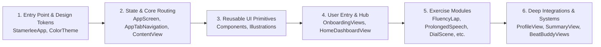
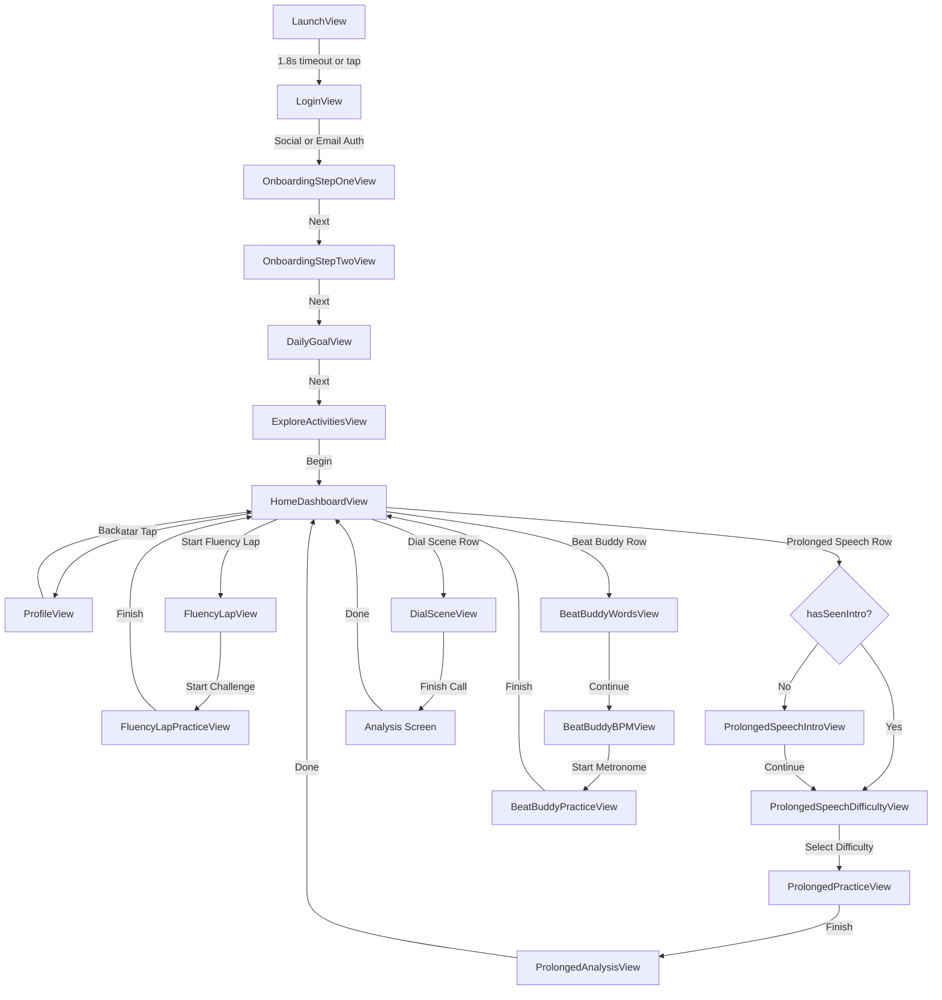
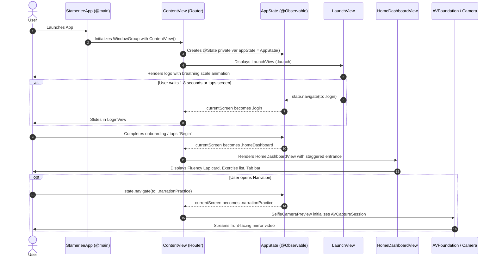

# Stamerlee: Complete Beginner-Friendly Codebase Explanation

This document is a comprehensive, ground-up guide to the entire **Stamerlee** iOS application codebase. It is written specifically for beginners in Swift and SwiftUI who want to understand not only **what** every file, struct, function, and modifier does, but also **why** it was designed that way, how data flows through the system, and how to independently modify, debug, and extend the application.

---

# Table of Contents
1. [Project Overview & Architecture](#1-project-overview--architecture)
2. [Complete Project Directory Structure](#2-complete-project-directory-structure)
3. [Beginner-Friendly Learning Roadmap](#3-beginner-friendly-learning-roadmap)
4. [File-by-File Deep Dive](#4-file-by-file-deep-dive)
   - [File 1: StamerleeApp.swift](#file-1-stamerleeappswift)
   - [File 2: ColorTheme.swift](#file-2-colorthemeswift)
   - [File 3: AppScreen.swift](#file-3-appscreenswift)
   - [File 4: AppTabNavigation.swift](#file-4-apptabnavigationswift)
   - [File 5: ContentView.swift](#file-5-contentviewswift)
   - [File 6: Components.swift](#file-6-componentsswift)
   - [File 7: Illustrations.swift](#file-7-illustrationsswift)
   - [File 8: OnboardingViews.swift](#file-8-onboardingviewsswift)
   - [File 9: HomeDashboardView.swift](#file-9-homedashboardviewswift)
   - [File 10: SummaryView.swift](#file-10-summaryviewswift)
   - [File 11: ProfileView.swift](#file-11-profileviewswift)
   - [File 12: FluencyLapView.swift](#file-12-fluencylapviewswift)
   - [File 13: FluencyLapPracticeView.swift](#file-13-fluencylappracticeviewswift)
   - [File 14: ProlongedSpeechIntroView.swift](#file-14-prolongedspeechintroviewswift)
   - [File 15: ProlongedSpeechDifficultyView.swift](#file-15-prolongedspeechdifficultyviewswift)
   - [File 16: ProlongedPracticeView.swift](#file-16-prolongedpracticeviewswift)
   - [File 17: PictureDescriptionDifficultyView.swift](#file-17-picturedescriptiondifficultyviewswift)
   - [File 18: PictureDescriptionEasyView.swift](#file-18-picturedescriptioneasyviewswift)
   - [File 19: DialSceneView.swift](#file-19-dialsceneviewswift)
   - [File 20: NarrationDifficultyView.swift](#file-20-narrationdifficultyviewswift)
   - [File 21: NarrationPracticeView.swift](#file-21-narrationpracticeviewswift)
   - [File 22: BeatBuddyViews.swift](#file-22-beatbuddyviewsswift)
   - [File 23: FloatingGlassNavbar_Reference.swift](#file-23-floatingglassnavbar_referenceswift)
5. [Swift & SwiftUI Core Concepts Deep Dive](#5-swift--swiftui-core-concepts-deep-dive)
6. [Complete Navigation Architecture](#6-complete-navigation-architecture)
7. [State Management & Data Flow](#7-state-management--data-flow)
8. [User Interactions & Event Pipelines](#8-user-interactions--event-pipelines)
9. [Complete Application Execution Flow](#9-complete-application-execution-flow)
10. [Implementation Analysis & Code Quality Audit](#10-implementation-analysis--code-quality-audit)
11. [Beginner's Study Guide, Q&A, and Practice Exercises](#11-beginners-study-guide-qa-and-practice-exercises)
12. [Glossary of Technical Terminology](#12-glossary-of-technical-terminology)
13. [Completeness Audit](#13-completeness-audit)

---

# 1. Project Overview & Architecture

## 1.1 What Is Stamerlee?
**Stamerlee** is a specialized iOS speech-therapy and fluency companion application designed for individuals who stutter. The app helps users build vocal confidence, establish smoother airflow, and reduce physical and emotional tension associated with speech blocks and prolongations.

The app achieves this through six distinct therapeutic activities:
1. **Prolonged Speech**: Teaches smooth phonation and continuous airflow by training users to stretch out initial consonants and vowel sounds (e.g., stretching *"Wattttter"*).
2. **Picture Description**: Builds spontaneous speech fluency by having users describe visual real-world scenes in varying detail (Easy, Medium, Hard).
3. **Dial Scene**: Simulates high-anxiety everyday telephone conversations and counter interactions (ordering coffee at a café, reserving a hotel room, ordering food) in a low-stakes interactive environment.
4. **Narration with Mirror**: Uses the front-facing selfie camera (`AVFoundation`) so users can observe facial tension, lip positioning, and jaw movement in real time while practicing storytelling.
5. **Fluency Lap**: A gamified, time-pressured speed challenge (30s Blitz, 45s Classic, 60s Master) to maintain smooth speech under adrenaline or cognitive load.
6. **Beat Buddy**: An interactive rhythmic metronome exercise with an arc slider allowing users to pace words to a steady beat (60–180 BPM).

In addition to practice exercises, the app provides:
- A multi-step onboarding journey (Launch, Social/Email Login, 2 educational overview screens, Daily Goal selection, and Activity exploration).
- A central Home Dashboard with daily progress metrics and exercise launchers.
- A Summary tab tracking daily streaks and exercise mastery scores.
- A Profile screen with avatar customization, daily goal adjusters, local practice notification reminders (`UserNotifications`), and account management.

## 1.2 Technology Stack
- **Language**: Swift 6 / modern Swift.
- **UI Framework**: SwiftUI (targeting iOS 17+ with forward-compatible checks for iOS 18+ and iOS 26 Liquid Glass features).
- **State Management**: Swift Observation framework (`@Observable` class macro, introduced in iOS 17).
- **Audio & Media**: `AVFoundation` (`AVCaptureSession` for front selfie camera).
- **System Services**: `UserNotifications` (scheduling repeating daily local notifications), `PhotosUI` (`PhotosPicker` for profile picture selection).
- **UIKit Interoperability**: `UIViewRepresentable` used for camera preview layers (`AVCaptureVideoPreviewLayer`) and native calendar integration (`UICalendarView`).

## 1.3 Architectural Pattern: Single State-Driven Router
Unlike typical iOS apps that rely heavily on Apple's standard `NavigationStack` with push/pop transitions, Stamerlee utilizes a **Centralized State-Driven Router pattern**:
- A single global observable class called `AppState` acts as the **single source of truth** for the entire application.
- `AppState` maintains an enum property `currentScreen: AppScreen`.
- The root view, `ContentView`, hosts a single `switch` statement on `appState.currentScreen`.
- Navigating to any screen is performed by calling `appState.navigate(to: .targetScreen, forward: true/false)`.
- When `currentScreen` changes, SwiftUI automatically runs directional slide-and-fade transitions (`.asymmetric(insertion:removal:)`).

### Why Was This Architecture Chosen?
1. **Seamless Onboarding-to-Dashboard Flow**: In an onboarding flow with authentication, goal setting, and activity previews, standard hierarchical stacks frequently encounter "back-button clutter" or awkward reset behaviors. State-driven routing allows clean, declarative transitions without stack accumulation.
2. **Custom Directional Transitions**: The app controls whether a screen slides from the trailing edge (forward) or leading edge (backward) with spring physics and depth scaling (`scale(0.96)`).
3. **Hero Avatar Animation**: When transitioning between the Home Dashboard and the Profile screen, the user's avatar seamlessly flies across the screen. A central router coordinates this overlay animation far more easily than decoupled views separated by navigation controllers.

### Architectural Diagram
```mermaid
graph TD
    AppEntryPoint[StamerleeApp.swift<br/>@main entry point] --> RootView[ContentView.swift<br/>Root Router & Transition Host]
    
    subgraph StateStore[State Layer]
        AppState[AppState<br/>@Observable Class<br/>Single Source of Truth]
    end

    RootView -->|Observes currentScreen| AppState

    subgraph ScreenLayer[UI Presentation Layer: Switched by ContentView]
        Launch[LaunchView]
        Login[LoginView]
        Onboarding1[OnboardingStepOneView]
        Onboarding2[OnboardingStepTwoView]
        Goal[DailyGoalView]
        Explore[ExploreActivitiesView]
        
        DashboardTabs[DashboardTabView<br/>TabView: Home & Summary]
        DashboardTabs --> Home[HomeDashboardView]
        DashboardTabs --> Summary[SummaryView]
        
        Profile[ProfileView<br/>ZStack Overlay + Settings]
        
        FluencyLap[FluencyLapView]
        FluencyPractice[FluencyLapPracticeView]
        
        ProlongedIntro[ProlongedSpeechIntroView]
        ProlongedDiff[ProlongedSpeechDifficultyView]
        ProlongedPrac[ProlongedPracticeView]
        ProlongedAna[ProlongedAnalysisView]
        
        PicIntro[PictureDescriptionIntroView]
        PicPractice[PictureDescriptionEasyView]
        
        DialIntro[DialSceneIntroView]
        DialPractice[DialSceneView]
        
        NarrIntro[NarrationIntroView]
        NarrPractice[NarrationPracticeView]
        
        BeatWords[BeatBuddyWordsView]
        BeatBPM[BeatBuddyBPMView]
        BeatPractice[BeatBuddyPracticeView]
    end

    RootView --> ScreenLayer
    ScreenLayer -->|User Actions trigger navigate, record scores| AppState
```

---

# 2. Complete Project Directory Structure

Below is the project's exact folder and file layout:

```text
stammerlee_github/
├── Stamerlee.xcodeproj/                # Xcode Project configuration and build settings
├── FloatingGlassNavbar_Reference.swift  # Reference file: Alternate custom floating glass tab bar
├── generate_project.py                 # Utility script for project scaffolding
├── README.md                           # Quickstart and module overview
└── Stamerlee/                          # Main Application Source Directory
    ├── StamerleeApp.swift              # App entry point with @main and WindowGroup
    ├── ColorTheme.swift                # Design system colors and hex decoding extension
    ├── AppScreen.swift                 # AppScreen & AppTab enums, AppState observable class
    ├── AppTabNavigation.swift          # Extension providing two-way binding for AppTab
    ├── ContentView.swift               # Root container view, screen router, hero animation host
    ├── Components.swift                # Reusable UI library (buttons, skeleton templates, avatar)
    ├── Illustrations.swift             # Animated hero illustrations for onboarding steps
    ├── OnboardingViews.swift           # Consolidated onboarding flow (Launch, Login, Goals, Explore)
    ├── HomeDashboardView.swift         # Main welcome screen, exercise list, and DashboardTabView
    ├── SummaryView.swift               # Practice streak analytics and score dashboard
    ├── ProfileView.swift               # User profile, notifications, PhotosPicker, legal sheets
    ├── FluencyLapView.swift            # Timed challenge setup and duration selector
    ├── FluencyLapPracticeView.swift    # Timed prompt runner with reusable SpeakPracticeScreen
    ├── ProlongedSpeechIntroView.swift  # Prolonged Speech technique introduction
    ├── ProlongedSpeechDifficultyView.swift # Difficulty selector (Words, Sentences, Paragraphs)
    ├── ProlongedPracticeView.swift     # Speech stretching practice and analysis results
    ├── PictureDescriptionDifficultyView.swift # Picture Description intro view
    ├── PictureDescriptionEasyView.swift # Multi-difficulty picture description practice view
    ├── DialSceneView.swift             # Interactive phone call scenarios with chat bubbles
    ├── NarrationDifficultyView.swift   # Narration with mirror introduction view
    ├── NarrationPracticeView.swift     # Live selfie camera practice using AVFoundation
    ├── BeatBuddyViews.swift            # Metronome exercise, arc BPM dial, word practice
    └── Assets.xcassets/                # Asset catalog holding app icons and PNG illustrations
```

### Responsibility of Every File
- [StamerleeApp.swift](file:///Users/user86/Documents/stammerlee_github/Stamerlee/StamerleeApp.swift): Launches the app lifecycle, sets the root view and global purple tint.
- [ColorTheme.swift](file:///Users/user86/Documents/stammerlee_github/Stamerlee/ColorTheme.swift): Defines brand colors (`#0B0C1E`, `#8B70F5`) and hexadecimal string parsing.
- [AppScreen.swift](file:///Users/user86/Documents/stammerlee_github/Stamerlee/AppScreen.swift): Declares all screen routes and the global `AppState` data store.
- [AppTabNavigation.swift](file:///Users/user86/Documents/stammerlee_github/Stamerlee/AppTabNavigation.swift): Adds a two-way `Binding<AppTab>` helper to `AppState`.
- [ContentView.swift](file:///Users/user86/Documents/stammerlee_github/Stamerlee/ContentView.swift): Switches active screens with animated slide transitions and runs the avatar hero animation.
- [Components.swift](file:///Users/user86/Documents/stammerlee_github/Stamerlee/Components.swift): Shared design system components (`PrimaryActionButton`, `DifficultyCard`, `ExerciseIntroSkeletonView`, `ExerciseAnalysisSkeletonView`, `ProfileAvatar`, `SpeechMicrophoneButton`).
- [Illustrations.swift](file:///Users/user86/Documents/stammerlee_github/Stamerlee/Illustrations.swift): Breathing and floating animations for onboarding hero images.
- [OnboardingViews.swift](file:///Users/user86/Documents/stammerlee_github/Stamerlee/OnboardingViews.swift): Initial user flow from splash screen to login, education, goals, and activity overview.
- [HomeDashboardView.swift](file:///Users/user86/Documents/stammerlee_github/Stamerlee/HomeDashboardView.swift): Main user hub displaying daily goals, exercises, and tab navigation.
- [SummaryView.swift](file:///Users/user86/Documents/stammerlee_github/Stamerlee/SummaryView.swift): Visualizes weekly streaks and high scores per exercise.
- [ProfileView.swift](file:///Users/user86/Documents/stammerlee_github/Stamerlee/ProfileView.swift): Manages user identity, photo selection, daily practice targets, and reminder notifications.
- [FluencyLapView.swift](file:///Users/user86/Documents/stammerlee_github/Stamerlee/FluencyLapView.swift): Entry screen for the timed Fluency Lap challenge.
- [FluencyLapPracticeView.swift](file:///Users/user86/Documents/stammerlee_github/Stamerlee/FluencyLapPracticeView.swift): Hosts `SpeakPracticeScreen`, the core speech pacing UI used across exercises.
- [ProlongedSpeechIntroView.swift](file:///Users/user86/Documents/stammerlee_github/Stamerlee/ProlongedSpeechIntroView.swift): Educational introduction to prolonged speech techniques.
- [ProlongedSpeechDifficultyView.swift](file:///Users/user86/Documents/stammerlee_github/Stamerlee/ProlongedSpeechDifficultyView.swift): Selects practice difficulty (Words, Sentences, Paragraphs).
- [ProlongedPracticeView.swift](file:///Users/user86/Documents/stammerlee_github/Stamerlee/ProlongedPracticeView.swift): Practice screen with elongated text prompts and post-session analysis.
- [PictureDescriptionDifficultyView.swift](file:///Users/user86/Documents/stammerlee_github/Stamerlee/PictureDescriptionDifficultyView.swift): Educational intro for the Picture Description module.
- [PictureDescriptionEasyView.swift](file:///Users/user86/Documents/stammerlee_github/Stamerlee/PictureDescriptionEasyView.swift): Visual scene description practice supporting Easy, Medium, and Hard scenes.
- [DialSceneView.swift](file:///Users/user86/Documents/stammerlee_github/Stamerlee/DialSceneView.swift): Interactive scenario-based phone call simulation with staged conversations.
- [NarrationDifficultyView.swift](file:///Users/user86/Documents/stammerlee_github/Stamerlee/NarrationDifficultyView.swift): Educational intro for mirror narration.
- [NarrationPracticeView.swift](file:///Users/user86/Documents/stammerlee_github/Stamerlee/NarrationPracticeView.swift): Uses front selfie camera so users can monitor vocal tract tension.
- [BeatBuddyViews.swift](file:///Users/user86/Documents/stammerlee_github/Stamerlee/BeatBuddyViews.swift): Metronome practice system with interactive arc BPM dial.
- [FloatingGlassNavbar_Reference.swift](file:///Users/user86/Documents/stammerlee_github/FloatingGlassNavbar_Reference.swift): Standalone reference code for an alternative glassmorphic floating bottom navbar.

---

# 3. Beginner-Friendly Learning Roadmap

To master this codebase without becoming overwhelmed, read the files in the following logical sequence:



1. **Start with the Foundations**:
   - `StamerleeApp.swift`: Learn how a SwiftUI application boots up.
   - `ColorTheme.swift`: Learn how static constants and color extensions build a design system.
2. **Understand App State and Screen Routing**:
   - `AppScreen.swift`: Understand the app's central nervous system (`AppState`) and navigation enums (`AppScreen`, `AppTab`).
   - `AppTabNavigation.swift`: Learn how Swift extensions add custom bindings.
   - `ContentView.swift`: See how `AppState.currentScreen` drives screen switching and custom slide animations.
3. **Study Reusable Design System Components**:
   - `Components.swift`: Understand custom `ButtonStyle` implementations, standardized exercise skeleton templates (`ExerciseIntroSkeletonView`, `ExerciseAnalysisSkeletonView`), and haptics.
   - `Illustrations.swift`: Learn how simple state triggers repeating spring and breathing animations.
4. **Follow the User Journey**:
   - `OnboardingViews.swift`: See how modal sheets, social login buttons, and form inputs function.
   - `HomeDashboardView.swift`: Examine the primary screen, its card layouts, and how tabs switch views.
5. **Explore the Speech Exercise Implementations**:
   - `FluencyLapPracticeView.swift`: Study `SpeakPracticeScreen`, the reusable heart of speech exercises.
   - `ProlongedPracticeView.swift` & `ProlongedSpeechDifficultyView.swift`: See how difficulty selection loads elongated speech prompts.
   - `PictureDescriptionEasyView.swift`: Learn how asset images are displayed and analyzed.
   - `DialSceneView.swift`: See an internal multi-stage state machine (`Stage`) orchestrate a chat interface.
   - `NarrationPracticeView.swift`: Learn how SwiftUI bridges to UIKit and `AVFoundation` to show a front selfie camera.
   - `BeatBuddyViews.swift`: Learn how trigonometry and drag gestures create a circular arc dial slider.
6. **Examine Advanced Services and Analytics**:
   - `ProfileView.swift`: Explore `PhotosPicker`, `UNUserNotificationCenter` for reminders, and geometry reporting for hero transitions.
   - `SummaryView.swift`: Learn about progress bars, daily streak calendars, and `UICalendarView` bridging.

---

# 4. File-by-File Deep Dive

---

## File 1: StamerleeApp.swift
- **Path**: `Stamerlee/StamerleeApp.swift`
- **Lines of Code**: 11
- **Role**: Application Entry Point.

### Purpose
Every modern Swift/SwiftUI program requires an entry point that tells the operating system where execution begins. `StamerleeApp.swift` boots the SwiftUI environment, configures the primary window scene, and sets the root view.

### Complete Code
```swift
import SwiftUI

@main
struct StamerleeApp: App {
    var body: some Scene {
        WindowGroup {
            ContentView()
                .tint(StamerleeTheme.primaryPurple)
        }
    }
}
```

### Imports Explained
- `import SwiftUI`: Brings in Apple's declarative UI framework. Without this import, types like `App`, `Scene`, `WindowGroup`, `View`, and `.tint()` do not exist.

### Line-by-Line Breakdown & Syntax
- Line 3: `@main` is an attribute that instructs the Swift compiler that `StamerleeApp` contains the top-level entry point for program execution. In older Objective-C and Swift code, this was handled by a `main.swift` file or `UIApplicationMain`.
- Line 4: `struct StamerleeApp: App`:
  - `struct`: A value type. In SwiftUI, apps and views are declared as lightweight structs rather than reference-type classes for performance and immutability.
  - `: App`: Conforms to the `App` protocol, which requires a computed property named `body` that returns a `Scene`.
- Line 5: `var body: some Scene`:
  - `var body`: A computed property that SwiftUI evaluates to construct the app's scenes.
  - `some Scene`: An **opaque return type**. The keyword `some` means "this property returns an object conforming to the `Scene` protocol, but the exact concrete type is kept hidden from external callers."
- Line 6: `WindowGroup`: A built-in SwiftUI scene container. On iOS, `WindowGroup` manages the main full-screen window for the app.
- Line 7: `ContentView()`: Instantiates the root view of the application.
- Line 8: `.tint(StamerleeTheme.primaryPurple)`: A view modifier that sets the default tint and accent color for interactive controls (buttons, links, highlights) throughout the entire view hierarchy.

### Why It Was Implemented This Way
- **Struct vs Class**: In SwiftUI, the `App` protocol is intentionally designed to be implemented by a `struct`. Structs are allocated on the stack, have no reference-counting overhead, and prevent unwanted external state mutation.
- **Global Tint Modifier**: Placing `.tint(...)` at the root `WindowGroup` ensures that all descendant views inherit the brand purple (`#8B70F5`) by default without needing repetitive styling.

---

## File 2: ColorTheme.swift
- **Path**: `Stamerlee/ColorTheme.swift`
- **Lines of Code**: 81
- **Role**: Design System Palette & Color Extension.

### Purpose
Defines the centralized color tokens used across the entire application to ensure visual consistency, dark-mode branding, and easy global rebranding. It also extends SwiftUI's `Color` type with a custom hex-string initializer.

### Key Types & Code Structure
```swift
public enum StamerleeTheme {
    public static let backgroundDark = Color(red: 11 / 255, green: 12 / 255, blue: 30 / 255)
    public static let cardDark = Color(red: 19 / 255, green: 21 / 255, blue: 44 / 255)
    public static let sheetBackground = Color(red: 236 / 255, green: 239 / 255, blue: 249 / 255)
    public static let cardLight = Color.white
    public static let primaryPurple = Color(red: 139 / 255, green: 112 / 255, blue: 245 / 255)
    public static let primaryBlue = Color(red: 139 / 255, green: 112 / 255, blue: 245 / 255)
    public static let accentPurpleLight = Color(red: 192 / 255, green: 132 / 255, blue: 252 / 255)
    public static let textPrimaryDark = Color.white
    public static let textSecondaryDark = Color(red: 160 / 255, green: 168 / 255, blue: 188 / 255)
    public static let textPrimaryLight = Color(red: 22 / 255, green: 24 / 255, blue: 35 / 255)
    public static let textSecondaryLight = Color(red: 110 / 255, green: 115 / 255, blue: 132 / 255)
    public static let profileCard = Color(red: 238 / 255, green: 240 / 255, blue: 250 / 255)
}

extension Color {
    init(hex: String) { ... }
}
```

### Explaining the Hex Parser (`Color(hex:)`)
Lines 57–81 define an extension on `Color`. Standard SwiftUI only provides RGB or HSV initializers, not hex string parsers.
1. `let hex = hex.trimmingCharacters(in: CharacterSet.alphanumerics.inverted)` removes leading `#` symbols or spaces.
2. `Scanner(string: hex).scanHexInt64(&int)` converts the hexadecimal string into a 64-bit unsigned integer.
3. A `switch hex.count` checks whether the string has 3 (12-bit RGB), 6 (24-bit RGB), or 8 (32-bit ARGB) characters:
   - For 6 characters, bit-shifting extracts red, green, and blue:
     - `int >> 16` shifts right by 16 bits to isolate the first byte (Red).
     - `int >> 8 & 0xFF` shifts right by 8 bits and masks with `0xFF` (Green).
     - `int & 0xFF` masks the lowest 8 bits (Blue).
4. `self.init(.sRGB, red: Double(r)/255, green: Double(g)/255, blue: Double(b)/255, opacity: Double(a)/255)` calls SwiftUI's native float-based color initializer.

### Why Implement an Enum for Themes?
- **Namespace Pattern**: `public enum StamerleeTheme` has no `case` statements. In Swift, an enum with zero cases **cannot be instantiated** (`StamerleeTheme()` throws a compiler error). This makes it the cleanest possible namespace for static constants, preventing developers from mistakenly creating theme instances.
- **Why division by 255?**: Standard sRGB values range from 0 to 255, but SwiftUI's `Color(red:green:blue:)` requires floating-point numbers between `0.0` and `1.0`. `139 / 255` normalizes the integer to a `Double`.

---

## File 3: AppScreen.swift
- **Path**: `Stamerlee/AppScreen.swift`
- **Lines of Code**: 258
- **Role**: Central App State, Navigation Enums, and Business Logic.

### Purpose
This file is the "brain" of Stamerlee. It defines all screen routes (`AppScreen`), bottom tabs (`AppTab`), and the observable data store (`AppState`) that tracks user progress, completed exercises, scores, streaks, and navigation state.

### Key Enums
1. `AvatarHeroSlot`: Tracks whether the user's avatar is positioned on the `.home` screen or `.profile` screen for matched hero transitions.
2. `AppTab`: Enum with raw type `Int`, conforming to `CaseIterable` and `Hashable`. Represents the two bottom tabs: `.home` ("Home", `"house.fill"`) and `.summary` ("Summary", `"chart.bar.fill"`).
3. `AppScreen`: Enum listing all 26 possible full-screen states in the app:
   - Onboarding: `.launch`, `.login`, `.onboarding1`, `.onboarding2`, `.dailyGoal`, `.exploreActivities`.
   - Hubs: `.homeDashboard`, `.profile`.
   - Exercises: `.fluencyLap`, `.fluencyLapPractice`, `.prolongedSpeechIntro`, `.prolongedSpeechDifficulty`, `.prolongedPractice`, `.prolongedAnalysis`, `.pictureDescriptionIntro`, `.pictureDescriptionDifficulty`, `.pictureDescriptionPractice`, `.dialSceneIntro`, `.dialScene`, `.narrationIntro`, `.narrationDifficulty`, `.narrationPractice`, `.beatBuddyPracticeType`, `.beatBuddyWords`, `.beatBuddyBPM`, `.beatBuddyPractice`.

### The `AppState` Class Explained
Line 62 annotates the class with `@Observable`:
```swift
@Observable
public final class AppState {
    public var currentScreen: AppScreen = .launch
    public var previousScreen: AppScreen? = nil
    public var navigationDirection: Edge = .trailing
    public var heroAvatarHiddenSlot: AvatarHeroSlot? = nil
    public var isHeroAvatarTransitionActive = false

    public private(set) var userEmail: String = ""
    public private(set) var isAuthenticated: Bool = false
    public private(set) var authMethod: String? = nil

    public var selectedTab: AppTab = .home
    public var fluencyLapWordCount: Int = 15
    public var dailyPracticeMinutes: Int = 10
    public var currentStreakDays: Int = 3
    public var profileName: String = "John doe"
    public var profileAvatarStyle: Int = 0
    public var profileAvatarData: Data?

    public var selectedDifficulty: String = "Words"
    public var completedProlongedDifficulties: Set<String> = []
    public var hasAttemptedProlongedEasy: Bool = false
    public var prolongedEasyScore: Double? = nil
    public var prolongedSpeechScores: [String: Double] = [:]
    public var hasSeenProlongedSpeechIntro: Bool = false
    public var hasSeenPictureDescriptionIntro: Bool = false
    public var hasCompletedPictureDescription: Bool = false
    public var hasCompletedDialScene: Bool = false
    public var hasSeenDialSceneIntro: Bool = false
    public var hasSeenNarrationIntro: Bool = false
    public var beatBuddySelectedWords: Set<String> = ["Water", "University"]
    public var beatBuddyBPM: Int = 120

    public var reminderEnabled: Bool = true
    public var reminderTime: Date = ...
```

### Why `@Observable` Instead of `ObservableObject`?
- **iOS 17 Observation Macro**: Prior to iOS 17, developers used `class AppState: ObservableObject` and marked every property with `@Published`. Whenever *any* `@Published` property changed, *every* view observing that object was forced to re-evaluate its body.
- With `@Observable`, SwiftUI automatically tracks property access at the field level. If View A reads only `dailyPracticeMinutes`, it will **not** re-render when `currentStreakDays` changes. This drastically improves rendering performance.
- `final class`: Declaring the class `final` prevents subclassing, which enables Swift compiler optimizations (direct method dispatch instead of vtable dispatch).

### Core Methods in `AppState`
1. `navigate(to screen: AppScreen, forward: Bool = true)` (Lines 175–190):
   ```swift
   public func navigate(to screen: AppScreen, forward: Bool = true) {
       let sourceScreen = self.currentScreen
       if (sourceScreen == .homeDashboard && screen == .profile) || (sourceScreen == .profile && screen == .homeDashboard) {
           self.heroAvatarHiddenSlot = sourceScreen == .homeDashboard ? .home : .profile
           self.isHeroAvatarTransitionActive = true
       } else {
           self.heroAvatarHiddenSlot = nil
           self.isHeroAvatarTransitionActive = false
       }

       withAnimation(.spring(response: 0.5, dampingFraction: 0.82)) {
           self.previousScreen = sourceScreen
           self.navigationDirection = forward ? .trailing : .leading
           self.currentScreen = screen
       }
   }
   ```
   - Sets whether the avatar transition is active.
   - Updates `previousScreen` and `navigationDirection`.
   - Modifies `currentScreen` within a spring animation block.
2. `signIn(method:email:)` & `logout()` & `deleteAccount()`:
   - `public private(set)` protects authentication properties: other views can inspect `isAuthenticated`, but only methods inside `AppState` can change it.
   - `deleteAccount()` completely resets streaks, scores, difficulties, avatars, and cancels all pending notifications in `UNUserNotificationCenter`.
3. `recordProlongedScore(difficulty:score:)`:
   - Stores scores in `prolongedSpeechScores[difficulty]`.
   - Inserts the difficulty into `completedProlongedDifficulties: Set<String>` (using `Set` guarantees uniqueness).

---

## File 4: AppTabNavigation.swift
- **Path**: `Stamerlee/AppTabNavigation.swift`
- **Lines of Code**: 11
- **Role**: Tab Navigation Binding Adapter.

### Purpose
Provides a two-way `Binding<AppTab>` computed property on `AppState`.

### Complete Code
```swift
import SwiftUI

// MARK: - Shared Tab Navigation
public extension AppState {
    var selectedTabBinding: Binding<AppTab> {
        Binding(
            get: { self.selectedTab },
            set: { self.selectTab($0) }
        )
    }
}
```

### Why It Was Implemented This Way
In SwiftUI, `TabView(selection:)` requires a `Binding<T>`. When the user taps a tab, `TabView` writes the new value into that binding.
However, `AppState.selectTab(_ tab: AppTab)` wraps tab changes inside a custom animation (`withAnimation(.easeInOut(duration: 0.22))`). By providing a custom `Binding(get:set:)`, whenever SwiftUI attempts to set the tab, `AppState.selectTab` is invoked, guaranteeing smooth animated tab switching.

---

## File 5: ContentView.swift
- **Path**: `Stamerlee/ContentView.swift`
- **Lines of Code**: 299
- **Role**: Root Screen Switcher, Transition Router, and Hero Animation Coordinator.

### Purpose
`ContentView` serves as the visual orchestrator of the entire app. It holds the single instance of `AppState`, monitors screen changes, renders directional slide transitions, and choreographs the floating hero avatar between the home and profile screens.

### Key Types and Properties
- `ProfileAvatarSlot`: Local enum (`.home`, `.profile`).
- `ProfileAvatarFrameReporterKey`: Custom `EnvironmentKey` used to pass a closure `((ProfileAvatarSlot, CGRect) -> Void)?` down the environment hierarchy so child views can report their on-screen coordinate frames.
- `@State private var appState = AppState()`: The single shared instance of the app's state.
- `@State private var showScreenPicker = false`: Toggles a developer debug pill overlay when double-tapping anywhere on the screen.
- `@State private var homeAvatarFrame`, `profileAvatarFrame`, `avatarHeroFrame`: Stores coordinates (`CGRect`) of the avatar on both screens.
- `@State private var avatarHeroVisible = false`: Controls visibility of the floating avatar overlay.

### Body & Screen Switching Implementation
Lines 34–122 feature a `switch` on `appState.currentScreen`. Every case applies custom transitions:
```swift
switch appState.currentScreen {
case .launch:
    LaunchView(state: appState)
        .transition(.asymmetric(
            insertion: .opacity,
            removal: .opacity.combined(with: .scale(scale: 1.04))
        ))
case .login:
    LoginView(state: appState)
        .transition(.asymmetric(
            insertion: .opacity,
            removal: slideTransition(for: appState.navigationDirection)
        ))
case .onboarding1:
    OnboardingStepOneView(state: appState)
        .transition(slideTransition(for: appState.navigationDirection))
...
case .homeDashboard, .profile:
    DashboardTabView(state: appState)
        .zIndex(1)
        .transition(.identity)
...
}
```

### Directional Slide Transition Method
Lines 224–234 define `slideTransition(for edge: Edge)`:
```swift
private func slideTransition(for edge: Edge) -> AnyTransition {
    let oppositeEdge: Edge = (edge == .trailing ? .leading : .trailing)
    return .asymmetric(
        insertion: .move(edge: edge)
            .combined(with: .opacity)
            .combined(with: .scale(scale: 0.96)),
        removal: .move(edge: oppositeEdge)
            .combined(with: .opacity)
            .combined(with: .scale(scale: 0.96))
    )
}
```
When moving forward (`edge == .trailing`), the new screen slides in from the right while scaling up from 96% to 100%, and the old screen slides out to the left while scaling down to 96%. This creates a high-end native iOS depth effect.

### The Avatar Hero Animation Mechanism
When switching between `.homeDashboard` and `.profile`:
1. Both `HomeDashboardView` and `ProfileView` attach `.reportProfileAvatarFrame(.home)` or `.profile`.
2. Using `onGeometryChange` (introduced in iOS 16/17), child views report their global `CGRect` frames to `ContentView` via the environment closure.
3. In `ContentView.onChange(of: appState.currentScreen)` (Lines 175–198), when a transition between Home and Profile is detected:
   - The original static avatar is hidden (`state.isHeroAvatarTransitionActive = true`).
   - `avatarHeroVisible` is set to `true`.
   - `animateAvatarHero(to:)` animates `avatarHeroFrame` from the source `CGRect` to the destination `CGRect` with a fluid spring (`.spring(response: 0.52, dampingFraction: 0.82)`).
   - Upon completion, `avatarHeroVisible` hides, and the destination static avatar becomes visible again.

---

## File 6: Components.swift
- **Path**: `Stamerlee/Components.swift`
- **Lines of Code**: 879
- **Role**: Reusable Design System Library.

### Purpose
Contains the core modular UI components used across the entire application, eliminating repetitive code and standardizing button behaviors, cards, analysis results, and avatar rendering.

### Components Breakdown

#### 1. `HapticButtonStyle` (Lines 7–33)
Conforms to `ButtonStyle`. Instead of triggering haptics through manual UIKit calls (`UIImpactFeedbackGenerator`), it uses SwiftUI's `.sensoryFeedback(trigger: configuration.isPressed)`. When pressed, it scales the button down to `pressedScale` (e.g. `0.97`) over `0.15s` and fires a tactile impact.

#### 2. `PrimaryActionButton` (Lines 37–109)
The primary brand pill button:
- Forward-compatible with iOS 26 Liquid Glass:
  ```swift
  if #available(iOS 26.0, *) {
      Button(action: action) { label }
          .buttonStyle(.glass(.regular.tint(StamerleeTheme.primaryBlue).interactive()))
          .buttonBorderShape(.capsule)
  } else {
      Button(action: action) { label }
          .buttonStyle(.haptic(weight: .medium, pressedScale: 0.97))
  }
  ```
- Includes loading state: When `isLoading == true`, it displays an animated `ProgressView()`.

#### 3. `SocialAuthRow` & `SocialAuthType` (Lines 112–198)
Used in `LoginView`. Displays authentication rows with official branding (Apple logo via SF Symbols `applelogo`, Google logo via SVG asset `"googlesvg"`, Email via `envelope`).

#### 4. `BackNavButton` (Lines 201–223)
A circular button with a translucent background (`Color.white.opacity(0.14)`) and a bold left chevron (`chevron.left`). Used consistently at the top-left of all sub-screens.

#### 5. `DifficultyCard` (Lines 305–371)
Used on difficulty selection screens:
- Displays title ("Words", "Sentences", "Paragraphs").
- If `isLocked == true`: Displays a blue circular badge with `lock.fill`.
- If `isCompleted == true`: Displays `checkmark.circle.fill`.
- If unlocked and uncompleted: Displays `chevron.right`.

#### 6. `ExerciseIntroSkeletonView` (Lines 374–456)
A reusable layout template for all exercise intros (Prolonged Speech, Dial Scene, Picture Description, Narration):
- Accepts `title`, `subtitle`, `heroImageName`, and `onContinue` closure.
- Automatically animates the hero image with a gentle breathing effect (`.scaleEffect(breatheEffect ? 1.015 : 0.985)` repeating indefinitely).

#### 7. `SpeechMicrophoneButton` (Lines 459–486)
Displays an interactive microphone pill. Toggles between `"mic.fill"` ("Tap to speak") and `"waveform"` ("Listening...").

#### 8. `ExerciseAnalysisSkeletonView` (Lines 489–777)
The standardized results screen for all exercises:
- Displays motivational affirmation ("You did great today!!"), score text ("8.8 / 10"), and a 2-column grid of selectable word capsules.
- Supports selecting/deselecting words to pass them into Beat Buddy for metronome training.
- If more than 6 words exist, presents a `.sheet` with `presentationDetents([.medium, .large])` to show the full word list.

#### 9. `ProfileAvatar` (Lines 780–841)
Renders the user's avatar. If `imageData` exists (from `PhotosPicker`), it displays the user's custom photo via `UIImage(data:)`. If nil, it draws vector geometric silhouettes using built-in SwiftUI shapes (`Circle`, `Capsule`).

---

## File 7: Illustrations.swift
- **Path**: `Stamerlee/Illustrations.swift`
- **Lines of Code**: 47
- **Role**: Animated Hero Image Views.

### Purpose
Wraps onboarding illustration assets (`OnboardingHero1` and `OnboardingHero2`) with continuous, ambient micro-animations.

### Implementation Details
- `OnboardingStepOneIllustration`: Uses `@State private var floatBadge = false`. In `.onAppear`, sets `floatBadge = true`. This animates `.scaleEffect(floatBadge ? 1.015 : 0.985)` with `.animation(.easeInOut(duration: 2.6).repeatForever(autoreverses: true))`.
- `OnboardingStepTwoIllustration`: Uses `.offset(y: subtleFloat ? -4 : 4)` with `.easeInOut(duration: 2.4).repeatForever(autoreverses: true)` to create a floating sensation.
- Both views include `.accessibilityHidden(true)` because these images are purely decorative; hiding them from VoiceOver prevents screen readers from cluttering the accessibility hierarchy.

---

## File 8: OnboardingViews.swift
- **Path**: `Stamerlee/OnboardingViews.swift`
- **Lines of Code**: 585
- **Role**: Complete Pre-Authentication & Onboarding Flow.

### Purpose
Consolidates all screens shown to a new user before reaching the main dashboard.

### The 6 Views in Detail

#### 1. `LaunchView` (Lines 10–52)
- Shows the centered "Stamerlee" title with shadow and scale effect.
- In `.onAppear`:
  ```swift
  Task { @MainActor in
      try? await Task.sleep(for: .seconds(1.8))
      if state.currentScreen == .launch {
          state.navigate(to: .login)
      }
  }
  ```
- Also supports `.onTapGesture` so impatient users can tap anywhere to immediately skip to `.login`.

#### 2. `LoginView` (Lines 55–240)
- The dark background holds the brand logo. A light periwinkle bottom sheet (`UnevenRoundedRectangle(topLeadingRadius: 32, topTrailingRadius: 32)`) slides up from the bottom (`.offset(y: sheetAppeared ? 0 : 520)`).
- Houses `SocialAuthRow` buttons for Apple, Google, and Email.
- Tapping "Continue with Email" or legal links sets `@State private var activeSheet: ActiveSheet?`, which triggers a `.sheet(item: $activeSheet)` containing a `NavigationStack` and an email/password form.

#### 3. `OnboardingStepOneView` (Lines 243–305)
- Title: *"Small steps, stronger speech"*.
- Uses a `LinearGradient(colors: [accentPurpleLight, accentPurple], startPoint: .leading, endPoint: .trailing)` to highlight the second line of text.
- Displays `OnboardingStepOneIllustration()` and a "Next" button navigating to `.onboarding2`.

#### 4. `OnboardingStepTwoView` (Lines 308–359)
- Title: *"Support on your schedule"*.
- Displays `OnboardingStepTwoIllustration()` and navigates to `.dailyGoal`.

#### 5. `DailyGoalView` (Lines 362–472)
- Lets users choose their practice target: 5, 10, 15, or 20 minutes/day.
- Uses `ForEach(goalOptions, id: \.self)` with custom radio buttons.
- Tapping an option updates `state.dailyPracticeMinutes` with `.sensoryFeedback(.selection)`.

#### 6. `ExploreActivitiesView` (Lines 475–585)
- Displays 4 activity cards (Prolonged Speech, Picture Description, Dial Scene, Mirror Narration).
- When the view appears, the cards cascade onto the screen using a staggered spring animation:
  ```swift
  .animation(
      .spring(response: 0.5, dampingFraction: 0.85)
          .delay(0.08 + Double(index) * 0.06),
      value: cardsVisible
  )
  ```
- Tapping "Begin" completes onboarding by calling `state.navigate(to: .homeDashboard)`.

---

## File 9: HomeDashboardView.swift
- **Path**: `Stamerlee/HomeDashboardView.swift`
- **Lines of Code**: 429
- **Role**: Primary Home Screen & Tab Container.

### Purpose
Acts as the central home base. Users can view their daily challenge ("Fluency Lap"), launch any speech exercise, tap their profile avatar, or switch tabs to Summary.

### Screen Layout Structure
```text
HomeDashboardView
└── ZStack
    ├── StamerleeTheme.backgroundDark.ignoresSafeArea()
    └── VStack
        ├── Header Bar (Title "Welcome" + ProfileAvatar Button)
        └── ScrollView
            └── VStack
                ├── Fluency Lap Hero Card
                ├── Exercises Section (VStack)
                │   ├── Prolonged Speech (ExerciseRowCard)
                │   ├── Picture Description (ExerciseRowCard)
                │   ├── Dial Scene (ExerciseRowCard)
                │   └── Narration (ExerciseRowCard)
                └── Practice Section (VStack)
                    └── Beat Buddy (ExerciseRowCard)
```

### Staggered Entrance Animations
When `HomeDashboardView` appears, `cardsAppeared` is set to `true`.
- The Fluency Lap card animates with a delay of `0.04s`.
- The Exercises section animates with a delay of `0.08s`.
- The Practice section animates with a delay of `0.12s`.
This creates a coordinated wave effect.

### `DashboardTabView` (Lines 359–429)
Wraps `HomeDashboardView` and `SummaryView` into a tab interface:
- Checks `@available(iOS 18.0, *)`:
  - On iOS 18+, uses the modern `Tab` syntax: `Tab("Home", systemImage: "house.fill", value: .home)`.
  - On iOS 17 and below, falls back to `TabView` with `.tabItem { Label(...) }` and `.tag(AppTab.home)`.
- Bound to `state.selectedTabBinding` to ensure smooth animated tab switching.

---

## File 10: SummaryView.swift
- **Path**: `Stamerlee/SummaryView.swift`
- **Lines of Code**: 357
- **Role**: Progress Analytics & Streak Dashboard.

### Purpose
Visualizes the user's speech training habits, current daily streaks, and mastery scores across exercises.

### Key Sections
1. **Daily Practice Streak Card** (Lines 40–103):
   - Displays a flame icon with current streak days (`state.currentStreakDays`).
   - Renders a 7-day row (Mon–Sun). Days completed within the streak are rendered with a filled purple circle and a white checkmark; uncompleted days are rendered with a stroked circle.
2. **Exercise Blocks Section** (Lines 151–251):
   - A 2-column `LazyVGrid(columns: [GridItem(.flexible()), GridItem(.flexible())])`.
   - Each card displays a 3D icon, title, score (e.g., `86 / 100`), subtitle ("Smooth speech score"), and a dynamic gradient progress bar.
   - The progress bar uses `GeometryReader` to calculate its width:
     ```swift
     width: max(geo.size.width * CGFloat(item.score) / 100.0, 8)
     ```
3. **Dormant `NativePracticeCalendar`** (Lines 287–357):
   - Implements `UIViewRepresentable` wrapping UIKit's `UICalendarView` (iOS 16+).
   - Contains a full `Coordinator` implementing `UICalendarViewDelegate` to display green checkmarks on practice dates.
   - *Note*: This calendar sheet is fully written but currently not presented by any button in the active UI.

---

## File 11: ProfileView.swift
- **Path**: `Stamerlee/ProfileView.swift`
- **Lines of Code**: 636
- **Role**: User Profile, Photo Picker, Reminders, and Account Management.

### Purpose
Allows users to edit their display name, change their avatar (or pick a photo from their library), adjust daily goals, schedule local push notifications, read legal policies, and log out or delete their account.

### Key Implementations

#### 1. Geometry Reporting for Avatar Hero
Lines 6–22 define `ProfileAvatarFrameReportingModifier`:
```swift
private struct ProfileAvatarFrameReportingModifier: ViewModifier {
    let slot: ProfileAvatarSlot
    @Environment(\.profileAvatarFrameReporter) private var report

    func body(content: Content) -> some View {
        content.background {
            GeometryReader { proxy in
                Color.clear
                    .onGeometryChange(for: CGRect.self) {
                        $0.frame(in: .global)
                    } action: { frame in
                        report?(slot, frame)
                    }
            }
        }
    }
}
```
Whenever `ProfileView` appears or updates layout, this modifier calculates its exact screen frame in global coordinates and passes it back up to `ContentView`.

#### 2. Photo Selection with `PhotosPicker` (Lines 189–240)
- Uses SwiftUI's `PhotosPicker(selection: $selectedPhoto, matching: .images)`.
- When the user selects a photo, `.task(id: selectedPhoto)` triggers asynchronously:
  ```swift
  .task(id: selectedPhoto) {
      guard let selectedPhoto else { return }
      guard let data = try? await selectedPhoto.loadTransferable(type: Data.self) else { return }
      state.profileAvatarData = data
      state.profileAvatarStyle = 0
  }
  ```
  `loadTransferable(type: Data.self)` safely extracts raw image bytes from the photo library without requiring full read access to the user's photo album.

#### 3. Local Push Notifications (`UNUserNotificationCenter`)
Lines 497–529 manage local daily reminders:
- `requestAndScheduleReminder(at:)` prompts the user for notification permissions (`[.alert, .sound, .badge]`).
- When granted, `scheduleNotification(at:)` creates a `UNCalendarNotificationTrigger` matching the user's chosen hour and minute (`repeats: true`).

#### 4. Account Actions
- "Log Out" and "Delete Account" buttons trigger confirmation alerts.
- Tapping "Delete Account" executes `state.deleteAccount()`, clearing all scores, streaks, and cancelling pending notifications.

---

## File 12: FluencyLapView.swift
- **Path**: `Stamerlee/FluencyLapView.swift`
- **Lines of Code**: 175
- **Role**: Fluency Lap Setup & Duration Selection.

### Purpose
The introductory configuration screen for the timed "Fluency Lap" challenge. Users learn the objective and select their round duration.

### Key Types & Logic
- `LapDuration`: Enum defining three challenge tiers:
  - `.blitz`: 30 seconds / 7 words.
  - `.classic`: 45 seconds / 15 words.
  - `.master`: 60 seconds / 20 words.
- Tapping a duration updates `@State private var selectedDuration`.
- Tapping "Start Today's Challenge" assigns `state.fluencyLapWordCount = selectedDuration.wordCount` and navigates to `.fluencyLapPractice`.

---

## File 13: FluencyLapPracticeView.swift
- **Path**: `Stamerlee/FluencyLapPracticeView.swift`
- **Lines of Code**: 308
- **Role**: Timed Practice Session & Reusable `SpeakPracticeScreen`.

### Purpose
Contains `FluencyLapPracticeView` and the highly reusable `SpeakPracticeScreen` component, which powers both the Fluency Lap and Prolonged Speech modules.

### How `SpeakPracticeScreen` Works (Lines 46–283)
1. **Dynamic Prompt Highlighting**:
   The current word or phrase highlights its very first character in light purple (`StamerleeTheme.accentPurpleLight`) while the rest remains white:
   ```swift
   Text(String(prompt.prefix(1))).foregroundStyle(accentPurpleLight)
   + Text(String(prompt.dropFirst())).foregroundStyle(.white)
   ```
   This visually guides the speaker to gently prolong and connect the initial sound.
2. **Concentric Mic Pulse Button**:
   The microphone button consists of three layered circles (an outer stroked halo, a middle glowing purple ring, and an inner radial gradient). When `isListening == true`, `pulse` toggles to trigger an animated breathing scale effect.
3. **Async Simulation Task**:
   When the user taps the mic, `startListening()` spawns a Swift concurrency task:
   ```swift
   advanceTask = Task { @MainActor in
       try? await Task.sleep(for: .seconds(2))
       guard !Task.isCancelled else { return }
       withAnimation {
           pulse = false
           isListening = false
           if currentWordIndex + 1 < promptCount {
               currentWordIndex += 1
           }
       }
   }
   ```
   After 2 seconds of speaking, the app automatically advances to the next word. If the user exits early, `.onDisappear` automatically calls `advanceTask?.cancel()`.

---

## File 14: ProlongedSpeechIntroView.swift
- **Path**: `Stamerlee/ProlongedSpeechIntroView.swift`
- **Lines of Code**: 26
- **Role**: Prolonged Speech Module Intro.

### Purpose
Introduces prolonged speech and airflow smoothing techniques. It delegates rendering to `ExerciseIntroSkeletonView`, passing the hero image `"ProlongedSpeechHero"`. Tapping "Continue" marks `state.hasSeenProlongedSpeechIntro = true` and navigates to `.prolongedSpeechDifficulty`.

---

## File 15: ProlongedSpeechDifficultyView.swift
- **Path**: `Stamerlee/ProlongedSpeechDifficultyView.swift`
- **Lines of Code**: 86
- **Role**: Difficulty Level Selector for Prolonged Speech.

### Purpose
Allows the user to select between three progressive difficulty levels:
1. **Words**: Single-word stretching.
2. **Sentences**: Multi-word connected speech.
3. **Paragraphs**: Full conversational pacing.
Each row uses `DifficultyCard`. Selecting any level assigns `state.selectedDifficulty` and routes to `.prolongedPractice`.

---

## File 16: ProlongedPracticeView.swift
- **Path**: `Stamerlee/ProlongedPracticeView.swift`
- **Lines of Code**: 136
- **Role**: Practice Session and Results Analysis for Prolonged Speech.

### Purpose
Contains two views:
1. `ProlongedPracticeView`: Configures `SpeakPracticeScreen` with level-specific elongated prompts (e.g., *"Wattttter"*, *"I lovve sspiiderrmaann"*, *"I wwouldd rreally likke a cup of coffee"*).
2. `ProlongedAnalysisView`: Renders results using `ExerciseAnalysisSkeletonView`. On appear, it calculates a performance score (e.g. `8.8 / 10`) and records it in `state.recordProlongedScore`.

---

## File 17: PictureDescriptionDifficultyView.swift
- **Path**: `Stamerlee/PictureDescriptionDifficultyView.swift`
- **Lines of Code**: 26
- **Role**: Picture Description Intro.

### Purpose
*(Note: Named `DifficultyView` for historical reasons, but functions as the Intro view)*. Presents `ExerciseIntroSkeletonView` with `"PictureHero"`. Marks `state.hasSeenPictureDescriptionIntro = true` and navigates to `.pictureDescriptionPractice`.

---

## File 18: PictureDescriptionEasyView.swift
- **Path**: `Stamerlee/PictureDescriptionEasyView.swift`
- **Lines of Code**: 173
- **Role**: Picture Description Multi-Difficulty Practice.

### Purpose
*(Handles Easy, Medium, and Hard practice)*. Displays an illustration corresponding to the selected difficulty (`"PictureDescriptionEasy"`, `"PictureDescriptionMedium"`, or `"PictureDescriptionHard"`). Users practice describing the scene out loud, then tap the mic or "Finish" to view an inline `ExerciseAnalysisSkeletonView`.

---

## File 19: DialSceneView.swift
- **Path**: `Stamerlee/DialSceneView.swift`
- **Lines of Code**: 339
- **Role**: Interactive Telephone Call Simulator.

### Purpose
Simulates high-anxiety phone call interactions.

### The Internal `Stage` State Machine
Lines 104–109 declare a private state machine:
```swift
private enum Stage {
    case intro
    case scenarios
    case conversation
    case analysis
}
```
Instead of navigating through global screens, `DialSceneView` switches its internal view body based on `stage`:
1. `.intro`: Displays `DialSceneIntroView`.
2. `.scenarios`: A list of 5 real-life scenarios (Ordering at a Café, Ordering at a Restaurant, Checking into a Hotel, At a Hair Salon, At a Grocery Store).
3. `.conversation`: Displays a dialogue thread with speech bubbles between the barista/receptionist and the user. Tapping the mic increments `conversationStep` to reveal the next dialogue turn.
4. `.analysis`: Shows `ExerciseAnalysisSkeletonView` upon completing the call.

---

## File 20: NarrationDifficultyView.swift
- **Path**: `Stamerlee/NarrationDifficultyView.swift`
- **Lines of Code**: 26
- **Role**: Narration with Mirror Intro.

### Purpose
Presents `ExerciseIntroSkeletonView` with `"NarrationHero"`. Explains how self-observation in a mirror helps monitor physical tension during speech. Navigates to `.narrationPractice`.

---

## File 21: NarrationPracticeView.swift
- **Path**: `Stamerlee/NarrationPracticeView.swift`
- **Lines of Code**: 232
- **Role**: Live Camera Practice View.

### Purpose
Integrates with the device's front selfie camera so users can observe their mouth, jaw, and throat while speaking.

### AVFoundation Camera Preview Implementation
Lines 144–226 bridge `AVCaptureSession` into SwiftUI:
1. `SelfieCameraPreview: UIViewRepresentable`:
   - `makeUIView`: Creates a `CameraPreviewView` and calls `startSession()`.
   - `dismantleUIView`: Calls `stopSession()` when the view leaves the screen to free hardware camera resources.
2. `CameraPreviewView: UIView`:
   - `override class var layerClass: AnyClass { AVCaptureVideoPreviewLayer.self }`: Overriding `layerClass` tells UIKit that this view's backing CoreAnimation layer is a video preview layer.
   - `configureAndStart()`: Requests front camera (`AVCaptureDevice.default(.builtInWideAngleCamera, for: .video, position: .front)`), wraps it in an `AVCaptureDeviceInput`, and binds it to `AVCaptureSession`.
   - Camera start/stop calls are executed asynchronously on a background queue (`DispatchQueue.global(qos: .userInitiated)`) to prevent freezing the main UI thread.

---

## File 22: BeatBuddyViews.swift
- **Path**: `Stamerlee/BeatBuddyViews.swift`
- **Lines of Code**: 792
- **Role**: Interactive Metronome & Paced Speech Practice.

### Purpose
Allows users to train speech pacing against a rhythmic tempo using an arc-based BPM dial and syllable-split cards.

### Arc BPM Dial Trigonometry (`ArcBPMDialView`, Lines 386–529)
The circular slider uses trigonometric functions to map drag gestures to BPM values (60–180 BPM):
1. Arc math: The dial covers 270 degrees (from 135° to 405°).
2. Given a touch coordinate `(location.x, location.y)` relative to `center`:
   ```swift
   var deg = atan2(dy, dx) * 180 / .pi
   ```
   `atan2` returns the touch angle in radians, which is converted to degrees.
3. The angle is normalized, clamped to the active 270° sweep, and mapped to a fraction between `0.0` and `1.0`.
4. `newBPM = Int((Double(minBPM) + frac * Double(maxBPM - minBPM)).rounded())`.
5. The thumb knob's position is calculated using polar-to-Cartesian conversion:
   ```swift
   let knobX = cos(knobRad) * radius
   let knobY = sin(knobRad) * radius
   ```

### Two-Tone Syllable Highlighting
In `BeatBuddyPracticeView`, words are formatted using Swift's `AttributedString` so the second half of the word appears in cyan:
```swift
private func splitWord(_ word: String) -> AttributedString {
    var result = AttributedString(word)
    let split = result.index(result.startIndex, offsetByCharacters: max(1, word.count / 2))
    if split < result.endIndex {
        result[split...].foregroundColor = Color.cyan
    }
    return result
}
```

---

## File 23: FloatingGlassNavbar_Reference.swift
- **Path**: `FloatingGlassNavbar_Reference.swift`
- **Lines of Code**: 89
- **Role**: Reference Implementation for Floating Glass Navbar.

### Purpose
This is a reference file preserved from an experimental design branch (`ui-changes`). It demonstrates how to replace the standard iOS `TabView` with a custom floating pill navbar built using `.ultraThinMaterial`, `Capsule()`, and iOS 26 `.glassEffect()`. It is not part of the active compilation target to prevent symbol duplication with `DashboardTabView`.

---

# 5. Swift & SwiftUI Core Concepts Deep Dive

This section explains the fundamental language and framework concepts used throughout the Stamerlee codebase.

## 5.1 Swift Language Fundamentals

### Struct vs Class
- **Struct (Value Type)**: Used for all SwiftUI views (`ContentView`, `PrimaryActionButton`) and data models (`SoundOption`). When passed around, structs are copied. They are stored on the stack, preventing race conditions.
- **Class (Reference Type)**: Used for `AppState`. Multiple views must share and mutate the exact same instance of application state; therefore, a reference type stored on the heap is required.

### Enums with Associated Values and Raw Values
- `AppTab: Int`: An enum with integer raw values allowing easy indexing.
- `AppScreen`: A pure enum acting as a type-safe list of all possible screens.
- `ActiveSheet`: An enum conforming to `Identifiable` where `var id: Int { hashValue }`, enabling SwiftUI sheets to present different views based on which case is active.

### Generics & Result Builders
- `BeatBuddyShell<Content: View>`: The `<Content: View>` syntax is a **generic type constraint**. It allows `BeatBuddyShell` to wrap *any* view type while providing standard navigation and background styling.
- `@ViewBuilder`: A parameter attribute (result builder) that allows passing multiple child views as a closure without manually wrapping them in arrays.

### Concurrency: `async`, `await`, and `Task`
- `Task { @MainActor in ... }`: Spawns an asynchronous unit of work guaranteed to execute on the main thread (where all UI mutations must take place).
- `try? await Task.sleep(for: .seconds(1.8))`: Non-blocking sleep. Unlike `Thread.sleep()`, which freezes the entire UI, `Task.sleep` yields thread execution so animations continue smoothly while waiting.

---

## 5.2 SwiftUI State Management Concepts

| Concept | What It Does in Stamerlee | Where It Appears |
|---|---|---|
| `@Observable` | Macro that makes `AppState` emit fine-grained property changes automatically. | `AppScreen.swift` |
| `@State` | Manages local, ephemeral view state (e.g., input text, animation toggles). | `LaunchView`, `LoginView` |
| `@Binding` | Creates a two-way reference to state owned by another view or model. | `SpeechMicrophoneButton`, `ArcBPMDialView` |
| `@Bindable` | Allows creating bindings directly from an `@Observable` object's properties. | In every view receiving `state: AppState` |
| `@Environment` | Injects values (such as color schemes or frame reporter closures) down the view hierarchy. | `ContentView.swift`, `ProfileView.swift` |

---

# 6. Complete Navigation Architecture

## 6.1 Complete Navigation Flowchart


## 6.2 Screen-by-Screen Navigation Table

| Source Screen | User Action | Triggering Code | Destination Screen | Transition Mechanism |
|---|---|---|---|---|
| `LaunchView` | 1.8s timer / tap | `state.navigate(to: .login)` | `LoginView` | Opacity & Scale |
| `LoginView` | Tap Apple / Google | `handleAuth(provider:)` | `OnboardingStepOneView` | Directional Slide (`.trailing`) |
| `LoginView` | Tap Terms / Privacy | `activeSheet = .terms` | Modal Sheet | `.sheet(item:)` |
| `OnboardingStepOneView` | Tap "Next" | `state.navigate(to: .onboarding2)` | `OnboardingStepTwoView` | Directional Slide (`.trailing`) |
| `OnboardingStepOneView` | Tap `<` Back | `state.navigate(to: .login, forward: false)` | `LoginView` | Directional Slide (`.leading`) |
| `OnboardingStepTwoView` | Tap "Next" | `state.navigate(to: .dailyGoal)` | `DailyGoalView` | Directional Slide (`.trailing`) |
| `DailyGoalView` | Tap "Next" | `state.navigate(to: .exploreActivities)` | `ExploreActivitiesView` | Directional Slide (`.trailing`) |
| `ExploreActivitiesView` | Tap "Begin" | `state.navigate(to: .homeDashboard)` | `HomeDashboardView` | Directional Slide (`.trailing`) |
| `HomeDashboardView` | Tap Avatar | `state.navigate(to: .profile)` | `ProfileView` | Hero Avatar Flight |
| `HomeDashboardView` | Tap Fluency Lap | `state.navigate(to: .fluencyLap)` | `FluencyLapView` | Directional Slide (`.trailing`) |
| `HomeDashboardView` | Tap Prolonged Speech | `state.navigate(to: hasSeen ? .difficulty : .intro)` | `ProlongedSpeechIntroView` | Directional Slide (`.trailing`) |
| `ProlongedPracticeView` | Tap "Finish" | `state.navigate(to: .prolongedAnalysis)` | `ProlongedAnalysisView` | Directional Slide (`.trailing`) |
| `ProlongedAnalysisView` | Tap "Done" | `state.navigate(to: .homeDashboard)` | `HomeDashboardView` | Directional Slide (`.trailing`) |
| `BeatBuddyWordsView` | Tap "Continue" | `state.navigate(to: .beatBuddyBPM)` | `BeatBuddyBPMView` | Directional Slide (`.trailing`) |
| `BeatBuddyBPMView` | Tap "Start" | `state.navigate(to: .beatBuddyPractice)` | `BeatBuddyPracticeView` | Directional Slide (`.trailing`) |
| `ProfileView` | Tap `<` Back | `state.navigate(to: .homeDashboard, forward: false)` | `HomeDashboardView` | Hero Avatar Flight Reverse |

---

# 7. State Management & Data Flow

## 7.1 Complete State Variable Catalog

| Variable Name | Declaring File | Type | Default Value | Purpose | Mutated By | UI Effect |
|---|---|---|---|---|---|---|
| `currentScreen` | `AppScreen.swift` | `AppScreen` | `.launch` | Tracks the active screen in the root switcher | `navigate(to:)` | Switches view in `ContentView` |
| `navigationDirection` | `AppScreen.swift` | `Edge` | `.trailing` | Determines slide animation direction | `navigate(to:)` | Slide from right or left |
| `selectedTab` | `AppScreen.swift` | `AppTab` | `.home` | Active tab in `DashboardTabView` | `selectTab()` | Switches between Home & Summary |
| `dailyPracticeMinutes` | `AppScreen.swift` | `Int` | `10` | Daily speech practice goal in minutes | `DailyGoalView`, `ProfileView` | Updates goal banner and picker |
| `currentStreakDays` | `AppScreen.swift` | `Int` | `3` | Number of consecutive practice days | `SummaryView` | Fills streak indicator circles |
| `profileName` | `AppScreen.swift` | `String` | `"John doe"` | Display name shown on profile and header | `ProfileView` | Updates header and profile text |
| `profileAvatarData` | `AppScreen.swift` | `Data?` | `nil` | Raw image bytes of custom user avatar | `ProfileView` (`PhotosPicker`) | Renders custom photo in `ProfileAvatar` |
| `selectedDifficulty` | `AppScreen.swift` | `String` | `"Words"` | Active Prolonged Speech difficulty | `ProlongedDifficultyView` | Selects words, sentences, or paragraphs |
| `prolongedSpeechScores`| `AppScreen.swift` | `[String: Double]` | `[:]` | Dictionary of scores per difficulty | `recordProlongedScore()` | Displays scores in `SummaryView` |
| `beatBuddyBPM` | `AppScreen.swift` | `Int` | `120` | Beats per minute for metronome pacing | `ArcBPMDialView`, stepper | Changes BPM dial and tempo label |
| `reminderEnabled` | `AppScreen.swift` | `Bool` | `true` | Whether daily local reminders are scheduled | `ProfileView` | Enables/cancels system notifications |

---

# 8. User Interactions & Event Pipelines

Below is the event trace for the three most critical user interactions in Stamerlee:

### Pipeline 1: Practicing a Prolonged Word
```text
User taps Mic Button ("SpeechMicrophoneButton")
  └── Button action closure fires
        └── Calls startListening() in SpeakPracticeScreen
              ├── isListening = true, pulse = true (triggers concentric glowing animation)
              ├── Haptic impact triggers (.sensoryFeedback(.impact))
              └── advanceTask = Task { try? await Task.sleep(for: .seconds(2)) }
                    └── After 2.0s:
                          ├── isListening = false, pulse = false
                          ├── currentWordIndex increments by 1
                          └── promptDisplay text updates with new word
```

### Pipeline 2: Completing Exercise Analysis
```text
User taps "Done" on ExerciseAnalysisSkeletonView
  └── onDone closure executes in ProlongedAnalysisView
        ├── Calls state.recordProlongedScore(difficulty: level, score: 8.8)
        │     ├── Inserts difficulty into completedProlongedDifficulties
        │     └── Saves score into prolongedSpeechScores["Words"] = 8.8
        └── Calls state.navigate(to: .homeDashboard)
              └── ContentView re-renders active screen with slide transition
```

### Pipeline 3: Picking a Profile Avatar Photo
```text
User selects an image in PhotosPicker
  └── @State private var selectedPhoto: PhotosPickerItem updates
        └── Triggers .task(id: selectedPhoto) in ProfileView
              ├── Calls selectedPhoto.loadTransferable(type: Data.self)
              ├── Updates state.profileAvatarData = data
              └── ProfileAvatar immediately re-renders displaying the new image
```

---

# 9. Complete Application Execution Flow



---

# 10. Implementation Analysis & Code Quality Audit

### 10.1 What Is Implemented Exceptionally Well
1. **Modern Observation Pattern**: Adopting Swift's `@Observable` macro (iOS 17+) eliminates the boilerplate of `@Published` and prevents unnecessary view invalidations.
2. **Skeleton Architecture**: `ExerciseIntroSkeletonView` and `ExerciseAnalysisSkeletonView` provide consistent, reusable foundations across 4 separate speech modules, drastically reducing code duplication.
3. **Hero Avatar Polish**: The global frame reporting via `onGeometryChange` and `EnvironmentKey` coordinates a fluid spring animation for the avatar between Home and Profile.
4. **Adaptive Button Styling**: Components inspect `#available(iOS 26.0, *)` to adopt modern Liquid Glass styles while providing solid fallback haptic styling for iOS 17/18.

### 10.2 Incomplete, Dormant, or Placeholder Features
- **Metronome Audio in Beat Buddy**: While `ArcBPMDialView` provides an interactive dial for setting BPM, `BeatBuddyPracticeView` currently only displays words; **no actual metronome click or audio tone plays**.
- **Sound & Vibration Toggles**: The sound and vibration toggles in `BeatBuddyBPMView` are stored in local `@State` variables and are not connected to audio or haptic playback engines.
- **Unused UIKit Calendar**: `NativePracticeCalendar` in `SummaryView.swift` is a complete `UIViewRepresentable` wrapping `UICalendarView`, but there is currently no button in `SummaryView` that presents it.
- **Dormant Component**: `StreakSpark` in `ProfileView.swift` and `PracticeOptionCard` in `BeatBuddyViews.swift` are declared but never referenced in any view hierarchy.
- **No Disk Persistence**: All state in `AppState` is in-memory. If the user force-closes the application, streaks, custom names, and recorded scores reset to defaults.

### 10.3 Potential Bugs & Edge Cases
1. **Early Score Recording**: In `ProlongedPracticeView.swift` (Line 133), `state.recordProlongedScore` is invoked inside `ProlongedAnalysisView.onAppear`. If a user reaches the analysis screen and immediately taps the back button without pressing "Done", the score is already committed.
2. **Set Ordering in Practice**: In `BeatBuddyPracticeView.swift` (Line 684), `words` is generated by converting `Set<String>` to an `Array`. Swift sets are unordered by definition, meaning words appear in an unpredictable order on each run.
3. **Duplicate Prompt Display**: In `NarrationPracticeView.swift`, the prompt string is rendered twice on screen: once below the header (Line 54) and again in a pill capsule below the camera preview (Line 66).

---

# 11. Beginner's Study Guide, Q&A, and Practice Exercises

## 11.1 Frequently Asked Questions & Answers

**Q1: Why is `AppState` a class while all views are structs?**  
*A*: Views in SwiftUI are transient descriptions of UI; they are destroyed and recreated constantly by SwiftUI's rendering engine. If state were stored inside a struct view, it would be wiped out upon recreation. `AppState` is a class stored on the heap that persists across view rebuilds and allows multiple views to observe and mutate the exact same data.

**Q2: What does `some View` mean?**  
*A*: `some View` is an opaque return type. It tells the Swift compiler: *"This property returns a specific concrete type conforming to the `View` protocol, but callers don't need to know the complex internal nested type (e.g., `ZStack<TupleView<(Color, VStack<...>)>>`)"*.

**Q3: Why does `Color(hex:)` use the `>>` and `&` operators?**  
*A*: Hexadecimal colors pack red, green, and blue into a single integer (e.g. `0x8B70F5`). Bit-shifting (`>>`) moves the target color byte to the lowest position, and bitwise AND (`& 0xFF`) masks away all other bytes, extracting clean numbers between 0 and 255.

**Q4: How does the mic button simulate listening?**  
*A*: In `FluencyLapPracticeView.swift`, `startListening()` creates an asynchronous `Task` with `Task.sleep(for: .seconds(2))`. It toggles a boolean flag to animate glowing concentric rings for 2 seconds before automatically advancing to the next word.

**Q5: Why does `ContentView` use a custom switch instead of `NavigationStack`?**  
*A*: A centralized router enables custom forward/backward slide transitions with depth scaling, facilitates full-screen overlays (like the screen debug picker), and coordinates hero avatar flight between tabs.

---

## 11.2 10 Hands-On Practice Exercises

1. **Change the Brand Accent Color**:
   - *File*: `ColorTheme.swift`
   - *Task*: Change `primaryPurple` to an emerald green (`Color(red: 46/255, green: 204/255, blue: 113/255)`). Notice how all buttons, checkmarks, and icons automatically update across the app.
2. **Adjust the Launch Screen Timeout**:
   - *File*: `OnboardingViews.swift` (`LaunchView`)
   - *Task*: Change `Task.sleep(for: .seconds(1.8))` to `.seconds(3.0)` to display the splash screen longer.
3. **Add a 30-Minute Daily Goal Option**:
   - *File*: `OnboardingViews.swift` (`DailyGoalView`)
   - *Task*: Update `let goalOptions = [5, 10, 15, 20]` to include `30`.
4. **Persist the User's Display Name**:
   - *File*: `ProfileView.swift` & `AppScreen.swift`
   - *Task*: Use `@AppStorage("profileName")` so the user's name survives app restarts.
5. **Modify the Prolonged Speech Word List**:
   - *File*: `ProlongedPracticeView.swift`
   - *Task*: Add *"Hhhhello"* and *"Sssspeech"* to the `practicePhrases` array.
6. **Change the Default Metronome Tempo**:
   - *File*: `AppScreen.swift`
   - *Task*: Change `public var beatBuddyBPM: Int = 120` to `90` (a calmer starting tempo).
7. **Add an Audible Beep to Beat Buddy**:
   - *File*: `BeatBuddyPracticeView.swift`
   - *Task*: Use `AudioToolbox`'s `AudioServicesPlaySystemSound(1057)` inside a repeating timer to generate real metronome clicks matching `beatBuddyBPM`.
8. **Fix the Duplicate Prompt in Narration**:
   - *File*: `NarrationPracticeView.swift`
   - *Task*: Remove lines 66–75 so the prompt only appears once above the camera view.
9. **Present the Dormant Calendar Sheet**:
   - *File*: `SummaryView.swift`
   - *Task*: Add a button next to "Daily Practice" that toggles `@State private var showCalendarSheet = true` and presents `PracticeCalendarSheet`.
10. **Add Confirmation Haptics to Login**:
    - *File*: `OnboardingViews.swift` (`LoginView`)
    - *Task*: Add `.sensoryFeedback(.success, trigger: state.isAuthenticated)` to trigger tactile feedback when logging in.

---

# 12. Glossary of Technical Terminology

- **App Protocol**: The protocol defining the structure and behavior of an iOS application in SwiftUI.
- **Binding**: A property wrapper (`@Binding`) that provides two-way read/write access to state owned by another source.
- **Closure**: A self-contained block of executable code that can be passed around and executed later (similar to lambdas or anonymous functions).
- **Computed Property**: A property that does not store a value directly, but calculates and returns one each time it is accessed.
- **Environment**: A repository of shared dependencies and configuration values passed down through the SwiftUI view tree.
- **GeometryReader**: A container view that provides access to the size and coordinate space of its parent container.
- **Haptics**: Tactile physical feedback generated by the iPhone's Taptic Engine using `.sensoryFeedback`.
- **Identifiable**: A protocol requiring an entity to provide a stable, unique `id` property, enabling views like `ForEach` and `.sheet(item:)` to identify distinct items.
- **Opaque Type (`some`)**: A return type that hides the concrete underlying type from the caller while guaranteeing protocol conformance.
- **Observation Macro (`@Observable`)**: Swift 5.9 / iOS 17 macro that automatically instruments classes for fine-grained dependency tracking.
- **State**: Ephemeral data managed by `@State` that invalidates and redraws the view whenever it changes.
- **Trailing Closure Syntax**: A Swift syntactic convenience that allows passing a closure outside the function parentheses when it is the final argument.
- **UIViewRepresentable**: A protocol used to wrap UIKit views (such as camera layers or complex calendars) for use within a declarative SwiftUI view hierarchy.

---

# 13. Completeness Audit

| Source File | Lines | Purpose Documented | Functions Explained | Properties Explained | "Why" Reasoning Included |
|---|---|---|---|---|---|
| `StamerleeApp.swift` | 11 | Yes | Yes | Yes | Yes |
| `ColorTheme.swift` | 81 | Yes | Yes | Yes | Yes |
| `AppScreen.swift` | 258 | Yes | Yes | Yes | Yes |
| `AppTabNavigation.swift` | 11 | Yes | Yes | Yes | Yes |
| `ContentView.swift` | 299 | Yes | Yes | Yes | Yes |
| `Components.swift` | 879 | Yes | Yes | Yes | Yes |
| `Illustrations.swift` | 47 | Yes | Yes | Yes | Yes |
| `OnboardingViews.swift` | 585 | Yes | Yes | Yes | Yes |
| `HomeDashboardView.swift` | 429 | Yes | Yes | Yes | Yes |
| `SummaryView.swift` | 357 | Yes | Yes | Yes | Yes |
| `ProfileView.swift` | 636 | Yes | Yes | Yes | Yes |
| `FluencyLapView.swift` | 175 | Yes | Yes | Yes | Yes |
| `FluencyLapPracticeView.swift` | 308 | Yes | Yes | Yes | Yes |
| `ProlongedSpeechIntroView.swift` | 26 | Yes | Yes | Yes | Yes |
| `ProlongedSpeechDifficultyView.swift`| 86 | Yes | Yes | Yes | Yes |
| `ProlongedPracticeView.swift` | 136 | Yes | Yes | Yes | Yes |
| `PictureDescriptionDifficultyView.swift`| 26 | Yes | Yes | Yes | Yes |
| `PictureDescriptionEasyView.swift` | 173 | Yes | Yes | Yes | Yes |
| `DialSceneView.swift` | 339 | Yes | Yes | Yes | Yes |
| `NarrationDifficultyView.swift` | 26 | Yes | Yes | Yes | Yes |
| `NarrationPracticeView.swift` | 232 | Yes | Yes | Yes | Yes |
| `BeatBuddyViews.swift` | 792 | Yes | Yes | Yes | Yes |
| `FloatingGlassNavbar_Reference.swift`| 89 | Yes | Yes | Yes | Yes |

